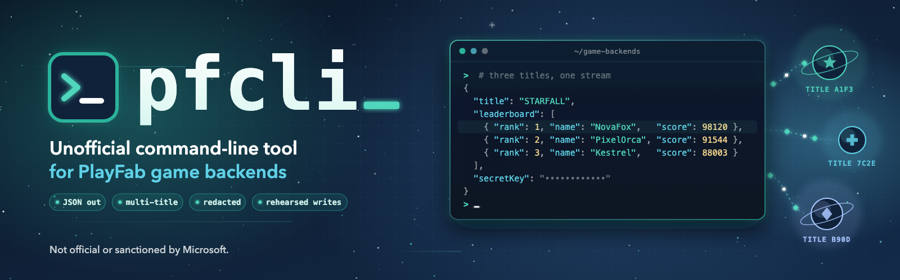

# playfab-cli-unofficial (`pfcli`)



A command-line tool for working with Microsoft PlayFab titles: read leaderboards, title data
and players with a title's secret key, act as a player through the Client API, run
CloudScript, and create, update and read players the way a game does. Output is PlayFab's own
JSON on stdout, reshaped by YAML output formats when needed.

> [!WARNING]
> **Unofficial. Not affiliated with, endorsed by, or supported by Microsoft, Azure PlayFab or
> PlayFab.** "PlayFab" and "Azure PlayFab" are trademarks of Microsoft. This tool calls the
> public PlayFab REST APIs with credentials you provide, and those credentials can change live
> data. **Use it at your own risk**; you are responsible for what it does to your titles. See
> [LICENSE](LICENSE) (MIT, no warranty).

## User documentation

**Installing, configuring and using pfcli:**

[Open the pfcli user guide](https://ericwastaken.github.io/playfab-cli-unofficial/)

The guide (built from `docs/`) is the source of truth for users: setup, the config and secrets
files, every command, output formats, player sessions, CloudScript and player sequences, and
troubleshooting. This README is for developers working on pfcli itself. For AI agents:
`SKILL.md` teaches an agent to **use** pfcli safely on a user's behalf; `AGENT.md` is for
agents **changing** pfcli's code.

## Development

Requires [uv](https://docs.astral.sh/uv/). The project pins Python 3.12 (`.python-version`).

```bash
uv sync
uv run pfcli.py --help
```

- Dependencies: `uv add <package>` (never `pip install` into a global Python). Runtime deps
  are `click`, `jmespath` and `pyyaml`; HTTP is the standard library (`urllib`).
- No PlayFab SDK, on purpose: every request goes through one client so access rules, dry runs
  and redaction cannot be bypassed.
- The `.venv` is not portable: after moving the folder, `rm -rf .venv && uv sync`.

### Local files (never committed)

Real configs, secrets, sessions and user formats are gitignored by pattern; see
`.gitignore`. Use `pfcli-config-<client>.yml` / `pfcli-secrets-<client>.yml` (the sessions
file `pfcli-sessions-<client>.yml` is created next to them), and `user-*.yml` for your own
output formats and request templates. Anything not matching these patterns is committable, so
keep client names, title IDs, hosts, keys and game-specific CloudScript out of it.

## The PlayFab REST API

pfcli is a thin client for PlayFab's **public REST API**, the same HTTP API Microsoft
documents for every PlayFab SDK. It sends plain HTTPS `POST` requests with JSON bodies to
`https://{titleId}.playfabapi.com/<Family>/<Endpoint>` (or a title's dedicated-cluster host),
and prints PlayFab's JSON replies unchanged. It uses no SDK and no private or undocumented
endpoints.

- **API reference:** [PlayFab REST API](https://learn.microsoft.com/en-us/rest/api/playfab/)
  and the [PlayFab API references overview](https://learn.microsoft.com/en-us/gaming/playfab/api-references/).
- **Families pfcli uses**, and how they authenticate:
  - [Server API](https://learn.microsoft.com/en-us/rest/api/playfab/server/): title secret key
    in the `X-SecretKey` header (`TitleClient`).
  - [Admin API](https://learn.microsoft.com/en-us/rest/api/playfab/admin/): title secret key in
    `X-SecretKey` (`TitleClient`).
  - [Client API](https://learn.microsoft.com/en-us/rest/api/playfab/client/): the player's
    session ticket in `X-Authorization`, obtained from
    [LoginWithCustomID](https://learn.microsoft.com/en-us/rest/api/playfab/client/authentication/login-with-custom-id)
    (`PlayerClient`).
- **Which calls a title allows for players** is governed by its
  [API access policy](https://learn.microsoft.com/en-us/gaming/playfab/api-references/api-access-policy);
  a denied call returns `403 NotAuthorizedByTitle`.

Endpoints currently registered in `ALLOWED_ENDPOINTS`, with their reference pages:

| Endpoint | Access | Reference |
|---|---|---|
| `Server/GetLeaderboard` | read | [docs](https://learn.microsoft.com/en-us/rest/api/playfab/server/player-data-management/get-leaderboard) |
| `Server/GetTitleData` | read | [docs](https://learn.microsoft.com/en-us/rest/api/playfab/server/title-wide-data-management/get-title-data) |
| `Server/GetPlayerCombinedInfo` | read | [docs](https://learn.microsoft.com/en-us/rest/api/playfab/server/player-data-management/get-player-combined-info) |
| `Server/GetPlayerProfile` | read | [docs](https://learn.microsoft.com/en-us/rest/api/playfab/server/account-management/get-player-profile) |
| `Server/GetPlayerStatisticVersions` | read | [Server API](https://learn.microsoft.com/en-us/rest/api/playfab/server/) |
| `Server/UpdateUserData` | write | [docs](https://learn.microsoft.com/en-us/rest/api/playfab/server/player-data-management/update-user-data) |
| `Client/LoginWithCustomID` | write | [docs](https://learn.microsoft.com/en-us/rest/api/playfab/client/authentication/login-with-custom-id) |
| `Client/GetLeaderboard` | read | [docs](https://learn.microsoft.com/en-us/rest/api/playfab/client/player-data-management/get-leaderboard) |
| `Client/GetPlayerProfile` | read | [docs](https://learn.microsoft.com/en-us/rest/api/playfab/client/account-management/get-player-profile) |
| `Client/GetUserData` | read | [docs](https://learn.microsoft.com/en-us/rest/api/playfab/client/player-data-management/get-user-data) |
| `Client/GetAccountInfo` | read | [docs](https://learn.microsoft.com/en-us/rest/api/playfab/client/account-management/get-account-info) |
| `Client/GetPlayerCombinedInfo` | read | [docs](https://learn.microsoft.com/en-us/rest/api/playfab/client/account-management/get-player-combined-info) |
| `Client/GetTitleData` | read | [docs](https://learn.microsoft.com/en-us/rest/api/playfab/client/title-wide-data-management/get-title-data) |
| `Client/GetCatalogItems` | read | [docs](https://learn.microsoft.com/en-us/rest/api/playfab/client/title-wide-data-management/get-catalog-items) |
| `Client/UpdateUserTitleDisplayName` | write | [docs](https://learn.microsoft.com/en-us/rest/api/playfab/client/account-management/update-user-title-display-name) |
| `Client/ExecuteCloudScript` | write | [docs](https://learn.microsoft.com/en-us/rest/api/playfab/client/server-side-cloud-script/execute-cloud-script) |
| `Server/GetFriendsList` | read | [docs](https://learn.microsoft.com/en-us/rest/api/playfab/server/friend-list-management/get-friends-list) |
| `Server/AddFriend` | write | [docs](https://learn.microsoft.com/en-us/rest/api/playfab/server/friend-list-management/add-friend) |
| `Server/RemoveFriend` | write | [docs](https://learn.microsoft.com/en-us/rest/api/playfab/server/friend-list-management/remove-friend) |
| `Server/UpdateAvatarUrl` | write | [docs](https://learn.microsoft.com/en-us/rest/api/playfab/server/account-management/update-avatar-url) |
| `Server/AddPlayerTag` | write | [docs](https://learn.microsoft.com/en-us/rest/api/playfab/server/play-stream/add-player-tag) |
| `Server/RemovePlayerTag` | write | [docs](https://learn.microsoft.com/en-us/rest/api/playfab/server/play-stream/remove-player-tag) |
| `Server/GetPlayerTags` | read | [docs](https://learn.microsoft.com/en-us/rest/api/playfab/server/play-stream/get-player-tags) |
| `Server/ConsumeItem` | write | [docs](https://learn.microsoft.com/en-us/rest/api/playfab/server/player-item-management/consume-item) |
| `Server/AddUserVirtualCurrency` | write | [docs](https://learn.microsoft.com/en-us/rest/api/playfab/server/player-item-management/add-user-virtual-currency) |
| `Server/SubtractUserVirtualCurrency` | write | [docs](https://learn.microsoft.com/en-us/rest/api/playfab/server/player-item-management/subtract-user-virtual-currency) |
| `Server/GetCatalogItems` | read | [docs](https://learn.microsoft.com/en-us/rest/api/playfab/server/title-wide-data-management/get-catalog-items) |
| `Server/GetLeaderboardAroundUser` | read | [docs](https://learn.microsoft.com/en-us/rest/api/playfab/server/player-data-management/get-leaderboard-around-user) |
| `Server/GetUserAccountInfo` | read | [docs](https://learn.microsoft.com/en-us/rest/api/playfab/server/account-management/get-user-account-info) |
| `Server/GetAllSegments` | read | [docs](https://learn.microsoft.com/en-us/rest/api/playfab/server/play-stream/get-all-segments) |
| `Server/GetPlayerSegments` | read | [docs](https://learn.microsoft.com/en-us/rest/api/playfab/server/play-stream/get-player-segments) |
| `Server/DeletePlayer` | write | [docs](https://learn.microsoft.com/en-us/rest/api/playfab/server/account-management/delete-player) |
| `Admin/UpdateUserTitleDisplayName` | write | [docs](https://learn.microsoft.com/en-us/rest/api/playfab/admin/account-management/update-user-title-display-name) |
| `Admin/AddPlayerTag` | write | [docs](https://learn.microsoft.com/en-us/rest/api/playfab/admin/play-stream/add-player-tag) |
| `Admin/RemovePlayerTag` | write | [docs](https://learn.microsoft.com/en-us/rest/api/playfab/admin/play-stream/remove-player-tag) |
| `Admin/GetPlayerTags` | read | [docs](https://learn.microsoft.com/en-us/rest/api/playfab/admin/play-stream/get-player-tags) |
| `Admin/AddUserVirtualCurrency` | write | [docs](https://learn.microsoft.com/en-us/rest/api/playfab/admin/player-item-management/add-user-virtual-currency) |
| `Admin/SubtractUserVirtualCurrency` | write | [docs](https://learn.microsoft.com/en-us/rest/api/playfab/admin/player-item-management/subtract-user-virtual-currency) |
| `Admin/GetCatalogItems` | read | [docs](https://learn.microsoft.com/en-us/rest/api/playfab/admin/title-wide-data-management/get-catalog-items) |
| `Admin/GetUserAccountInfo` | read | [docs](https://learn.microsoft.com/en-us/rest/api/playfab/admin/account-management/get-user-account-info) |
| `Admin/GetAllSegments` | read | [docs](https://learn.microsoft.com/en-us/rest/api/playfab/admin/play-stream/get-all-segments) |
| `Admin/GetPlayerSegments` | read | [docs](https://learn.microsoft.com/en-us/rest/api/playfab/admin/play-stream/get-player-segments) |
| `Admin/ExportPlayersInSegment` | read | [docs](https://learn.microsoft.com/en-us/rest/api/playfab/admin/play-stream/export-players-in-segment) |
| `Admin/GetSegmentExport` | read | [docs](https://learn.microsoft.com/en-us/rest/api/playfab/admin/play-stream/get-segment-export) |
| `Admin/DeletePlayer` | write | [docs](https://learn.microsoft.com/en-us/rest/api/playfab/admin/account-management/delete-player) |
| `Admin/DeleteMasterPlayerAccount` | write | [docs](https://learn.microsoft.com/en-us/rest/api/playfab/admin/account-management/delete-master-player-account) |
| `Client/GetFriendsList` | read | [docs](https://learn.microsoft.com/en-us/rest/api/playfab/client/friend-list-management/get-friends-list) |
| `Client/AddFriend` | write | [docs](https://learn.microsoft.com/en-us/rest/api/playfab/client/friend-list-management/add-friend) |
| `Client/RemoveFriend` | write | [docs](https://learn.microsoft.com/en-us/rest/api/playfab/client/friend-list-management/remove-friend) |
| `Client/UpdateAvatarUrl` | write | [docs](https://learn.microsoft.com/en-us/rest/api/playfab/client/account-management/update-avatar-url) |
| `Client/GetPlayerTags` | read | [docs](https://learn.microsoft.com/en-us/rest/api/playfab/client/play-stream/get-player-tags) |
| `Client/ConsumeItem` | write | [docs](https://learn.microsoft.com/en-us/rest/api/playfab/client/player-item-management/consume-item) |
| `Client/AddUserVirtualCurrency` | write | [docs](https://learn.microsoft.com/en-us/rest/api/playfab/client/player-item-management/add-user-virtual-currency) |
| `Client/SubtractUserVirtualCurrency` | write | [docs](https://learn.microsoft.com/en-us/rest/api/playfab/client/player-item-management/subtract-user-virtual-currency) |
| `Client/GetLeaderboardAroundPlayer` | read | [docs](https://learn.microsoft.com/en-us/rest/api/playfab/client/player-data-management/get-leaderboard-around-player) |
| `Client/GetPlayerSegments` | read | [docs](https://learn.microsoft.com/en-us/rest/api/playfab/client/play-stream/get-player-segments) |

When you register a new endpoint, add it to this table with its reference page. Request
and response shapes are exactly those in the reference; pfcli does not translate them.

## Architecture

```
pfcli.py                    Click root group: global options, lazy App (config, sessions,
                            emitter), `server` and `client` groups
lib/config.py               config + secrets loading: titles, hosts, cloudscripts allow list,
                            player sequences, redact patterns; paired-file resolution
lib/client.py               ALLOWED_ENDPOINTS registry; TitleClient (Server/Admin, secret
                            key) and PlayerClient (Client, session ticket); envelopes,
                            retries, dry runs, credential scrubbing (protect)
lib/pfcommand.py            pf_command decorator: access tag, endpoint checks, help, --dry-run
lib/output.py               Emitter (NDJSON / --raw) and OutputFormat (JMESPath rows/fields)
lib/inputs.py               input rows (CSV/NDJSON), request templates, placeholders, --var
lib/sessions.py             player session store (chmod 600), expiry, redaction helpers
lib/files.py                NAME vs path lookup for formats and templates
lib/commands/titles.py      `titles` (+ `--verify`: one harmless Server/GetTitleData per title)
lib/commands/admin/segment_export.py  async segment export: start, poll (--wait), download
lib/commands/init.py        `init`: creates/extends a config + chmod-600 secrets pair (LOCAL WRITE)
lib/commands/common.py      shared paging/concurrency helpers
lib/commands/endpoints.py   table-driven commands for simple flat endpoints (server/admin/client)
lib/commands/server/*.py    `server` commands with their own logic, one module each
lib/commands/client/*.py    `client` commands with their own logic, plus sessions and sequences
output-formats/*.yml        built-in output formats (user-*.yml are local)
request-templates/*.yml     built-in request templates (user-*.yml are local)
docs/, mkdocs.yml           user guide (GitHub Pages)
```

### Request flow

1. A command declares itself with `pf_command(name, access, endpoints, ...)`. Access is
   `READ ONLY`, `READ WRITE` (calls a write endpoint; gets `--dry-run`) or `LOCAL WRITE`
   (changes a local file only; gets `--dry-run`). Declarations are checked at import, so a
   `READ ONLY` command that lists a write endpoint fails immediately.
2. Every endpoint is registered in `lib/client.py` `ALLOWED_ENDPOINTS` as
   `"<Family>/<Name>": READ | WRITE`, named as in PlayFab's REST API (`Server/...`,
   `Admin/...`, `Client/...`). Unregistered endpoints raise before any request.
3. Bodies are built from options, request templates or the config, resolved by
   `lib/inputs.resolve` before the first call: `$.column` (input row), reserved
   `$session $playFabId $customId $titleId`, `$NAME` / optional `$NAME?` from `--var`.
   Rule: the CLI supplies values, never structure.
4. `TitleClient.call()` / `PlayerClient.call()` POST and return an envelope
   `{title, titleId, endpoint, at, request, response}` with PlayFab's reply untouched (errors
   included). Under `--dry-run`, write endpoints return `{dryRun: true, response: null}`.
   `protect()` scrubs the session ticket and the title's `redact` patterns from the whole
   envelope; some CloudScripts echo credentials back.
5. Commands pass every record to `ctx.obj.emitter.emit()`. stdout carries only records
   (NDJSON by default, `--raw` for the response only, `-o` for an output format); logs,
   warnings and errors go to stderr. Commands never print data directly, so formats always
   see everything.

### Client API and sessions

`client login-with-custom-id` (and `create-player`) save one session per (title ID, custom
ID) in the sessions file; every other client command looks it up with `--custom-id` and never
logs in by itself (`for_each_session` in `lib/commands/client/common.py`). Every client
command's help carries `SESSION_NOTES`. Tickets older than ~24 h, or rejected by PlayFab, are
skipped with a "log in again" message.

### Title-defined behavior

`cloudscripts` (allow list with `writes` and `parameter`) and `player.create|update|state`
(steps: `cloudscript: NAME` or `call: Family/Endpoint`) live in the user's config, because they
are unique to each game. `lib/commands/client/sequences.py` plans (all checks, before any
call) and runs them; `player.state` must contain only reads.

## Security

pfcli handles live credentials for production game backends. Treat every change as
security-relevant. The user-facing version of this section is the guide's
[Security](https://ericwastaken.github.io/playfab-cli-unofficial/safety/) page.

### Credentials pfcli touches

| Credential | Power | Where it lives | How pfcli protects it |
|---|---|---|---|
| Title secret key | Full Server + Admin access to one title (read **and write** everything) | `pfcli-secrets-<client>.yml` (or `PFCLI_SECRET_<TITLE_ID>` env var) | Gitignored by pattern; warning if the file is not `chmod 600`; sent only in `X-SecretKey`; never printed (`titles` shows `set`/`EMPTY`) |
| Player session ticket | Acts as that player on that title until it expires (~24 h) | `pfcli-sessions-<client>.yml` | Gitignored; written atomically with mode `0600`; sent only in `X-Authorization`; scrubbed from every emitted record, request **and** response (`protect()`), because some CloudScripts echo it back |
| Entity token (from login) | Entity API access for the player | Not stored | Redacted in login output (`sessions.redact`) |
| Game-specific credentials (e.g. secondary login keys a CloudScript returns) | Can log in as the player | Not stored | Title `redact` regex list in the user config; applied to every record by `protect()` |

### Guarantees and their limits

- **The credential is the security boundary, not pfcli.** `ALLOWED_ENDPOINTS`, access tags,
  the CloudScript allow list and `--dry-run` prevent *accidents*; they do not limit what a
  leaked key or ticket can do with any other HTTP client. A title secret key is full access.
- **`--dry-run` only skips writes pfcli knows are writes.** Reads still run, and CloudScript
  functions marked `writes: false` in the user's config are sent; that flag is trusted.
- **Redaction is exact-match (tickets) plus regex (`redact`).** A credential that pfcli does
  not know about and that matches no pattern will be printed if PlayFab returns it.
- **Output contains player data.** Display names, PlayFab IDs and user data can be personal
  data; pfcli does not anonymize. Users must handle output under their own privacy rules.
- **Flushing a session does not revoke it.** The Client API has no logout; a ticket stays
  valid at PlayFab until it expires. If a sessions file leaks, the tickets in it are live for
  up to ~24 h.
- **Transport is HTTPS** to `*.playfabapi.com` by default. `host` is user-configurable (and
  `http://` is used only for local fake-server testing); never point a real title's `host`
  anywhere but PlayFab.
- **No telemetry**: pfcli talks only to the configured PlayFab hosts.
- **Keys are never options or chat input.** `pfcli init` creates the secrets file with empty
  slots (`0600`) and tells the user to paste keys in an editor, so keys never land in shell
  history or agent transcripts.
- **Setup errors explain themselves.** `error_text()` adds a fix-it hint for
  `InvalidAPIEndpoint` (dedicated cluster / wrong title ID) and rejected secret keys, pointing
  to `pfcli titles --verify`; there is deliberately no automatic pre-flight call.
- **URL query strings are always redacted** in output (`SIGNED_URL` in `_scrub`): download
  links PlayFab returns (segment exports) are pre-signed, so the query string is a credential.
  Code that must follow such a link uses `TitleClient.call_raw()` (reads only) and never
  prints the raw reply. Downloaded exports default to the Git-ignored `pfcli-exports/`.
- **Writes are never retried on a server error.** HTTP 429 (rate limited, nothing done) is
  retried with backoff; HTTP 5xx is retried only for reads. A write that fails with 5xx may
  already have been applied (e.g. items granted), so pfcli stops and says to check first.

### Rules for contributors

1. **Every record goes through `protect()`.** Use `TitleClient.call()` /
   `PlayerClient.call()` (they protect) and `ctx.obj.emitter.emit()`. Never print or log a
   request body, response body, header or file content directly; log lines must not contain
   bodies, keys or tickets (dry-run logs name the endpoint only).
2. **New credential types** (entity tokens, new login methods) must be stored only in
   gitignored, `0600` files, redacted in output, and documented in the table above.
3. **New write endpoints** are registered as `WRITE`; their commands are `READ WRITE` with
   `--dry-run`. Calls that can create accounts, spend currency, grant items or change policy
   need explicit, separately named commands.
4. **Nothing client-specific is committed**: no client names, title IDs (check against the
   owner's inventory, see `AGENT.md`), hosts, keys, tickets, player data or game CloudScript.
   Real-looking example IDs are forbidden; use the existing placeholders.
5. **Dependencies**: keep them minimal (`click`, `jmespath`, `pyyaml`), pinned in `uv.lock`;
   no PlayFab SDK.

### Reporting a vulnerability

Please do not open a public issue. Use GitHub's
[private vulnerability reporting](https://github.com/ericwastaken/playfab-cli-unofficial/security/advisories/new)
for this repository.

## Adding a command

**Simple flat endpoint** (a player or title plus a few fields, no paging or templates): add an
`EndpointSpec` to `SPECS` in `lib/commands/endpoints.py` (endpoint, scope `player` / `title` /
`session` / `session_target`, fields, optional `guard` `"bulk"` or `"always"`) and register the
endpoint. `build_command()` creates the Click command with the standard options, access tag,
`--dry-run`, and the `--yes` guard: writes on more than 10 targets or several titles, and every
`"always"` write (deletions), refuse to run without `--yes`.

**Anything with real logic** (paging, request templates, sequences, sessions handling):

1. Create `lib/commands/<group>/<name>.py` with `@pf_command("<endpoint-in-kebab-case>",
   READ_ONLY | READ_WRITE, ("Family/Endpoint",))`. Commands that call PlayFab take `ALIAS...`
   (one or more titles), keep going when one title fails, and exit 1 if any failed.
2. Register new endpoints in `ALLOWED_ENDPOINTS` with `READ` or `WRITE`.
3. Call through `TitleClient` or `PlayerClient` (pass `dry_run` for writes); emit every
   envelope; report problems on stderr. Client commands pass `notes=SESSION_NOTES` and use
   `for_each_session`.
4. Small flat PlayFab-defined requests get options; nested ones get `--request` templates;
   title-defined shapes belong in the config. Values come from `--var`.
5. Register the command in `pfcli.py` and document it in `docs/` (user guide). New config
   keys go in `lib/config.py`, `pfcli-config.example.yml` and the configuration reference.

## Testing

There is no automated test suite yet. Changes are verified by running commands:

- Read-only commands against a real title (`server ...`, `client get-...`).
- Writes with `--dry-run` first; real writes only on a dev title with test players.
- Client and sequence paths against a small local fake PlayFab server (an `http.server`
  script that mimics the endpoints), pointed at by a throwaway config's `host`.

Before every commit, check that committable files contain no client names, title IDs,
hosts, keys or session tickets.

## Documentation

`docs/` is the only source of the user guide; `mkdocs.yml` defines the site (MkDocs Material).
Build it locally with:

```bash
uvx --with mkdocs-material==9.6.18 mkdocs build --strict
uvx --with mkdocs-material==9.6.18 mkdocs serve   # preview on http://127.0.0.1:8000
```

`.github/workflows/docs.yml` builds pull requests strictly and deploys `site/` to GitHub Pages
after pushes to `main` that touch the docs. Generated HTML (`site/`) is never committed.
Before the first deployment, set **Settings → Pages → Source: GitHub Actions** on the
repository.

## License

[MIT](LICENSE). Not affiliated with Microsoft or Azure PlayFab; use at your own risk.
