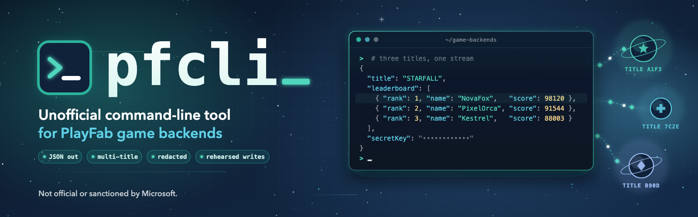

# pfcli user guide

<picture class="hero">
    <source media="(max-width: 640px)" srcset="assets/pfcli-banner-mobile.png">
    
</picture>

**pfcli** is an unofficial command-line tool for **Microsoft PlayFab** titles. Point it at your
titles once, then read leaderboards and title data, look up players in bulk, act as a player
the way a game client does, run CloudScript, and get the results as JSON, CSV or a tidy table.

!!! warning "Unofficial: use at your own risk"
    pfcli is **not affiliated with, endorsed by, or supported by Microsoft, Azure PlayFab or
    PlayFab**. It calls PlayFab's public REST APIs with the keys and logins **you** provide, and
    those can change live data. You are responsible for what you run against your titles.
    Start on a development title, and use `--dry-run` before anything that writes.
    [Read how pfcli keeps you safe](safety.md).

[Install pfcli](install.md){ .md-button .md-button--primary }
[Set up your titles](getting-started/setup.md){ .md-button }

!!! tip "Agent friendly :material-robot:"
    pfcli is built to be driven by AI coding agents (Claude Code, Codex, Cursor and others).
    **Point your agent at [`SKILL.md`](https://github.com/ericwastaken/playfab-cli-unofficial/blob/main/SKILL.md)**
    to use pfcli safely on your behalf, or at
    [`AGENT.md`](https://github.com/ericwastaken/playfab-cli-unofficial/blob/main/AGENT.md)
    to work on pfcli's code. [How to use pfcli with an agent](agents.md)

## What you can do

-   **Read your titles**

    Pull leaderboards (as deep as you like), TitleData, and players' combined info, for one
    title or many at once.

    [Your first commands](getting-started/first-commands.md)

-   **Get the output you need**

    By default you get PlayFab's own JSON, ready for `jq` or a file. Add an output format to
    turn it into CSV, a table, or just the fields you care about.

    [Shape the output](guides/output-formats.md)

-   **See what a player sees**

    Log in as a test player and call the Client API, just like the game does. Great for
    checking what your title exposes to players.

    [Act as a player](guides/act-as-a-player.md)

-   **Do it the game's way**

    Describe how your game creates, updates and reads players (CloudScript or a series of
    calls) once, then run it with one command.

    [CloudScript and player sequences](guides/cloudscript-and-sequences.md)

## Find what you need

-   :material-download: **Install**

    ---

    One `uv tool install` command, and `pfcli` is ready to use.

    [Install pfcli](install.md)

-   :material-rocket-launch: **Get started**

    ---

    Describe your titles, add their keys, and run your first commands.

    [Set up your titles](getting-started/setup.md)

-   :material-book-open-variant: **Look something up**

    ---

    Every command, every config key, and what the output looks like.

    [Commands](reference/commands.md) · [Config files](reference/configuration.md)

-   :material-lifebuoy: **Fix a problem**

    ---

    Common errors and what to do about them.

    [Troubleshooting](troubleshooting.md)

!!! info "Looking for developer documentation?"
    How pfcli is built, and how to add commands, is in the
    [GitHub repository](https://github.com/ericwastaken/playfab-cli-unofficial).
